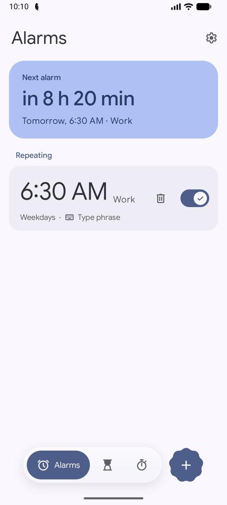
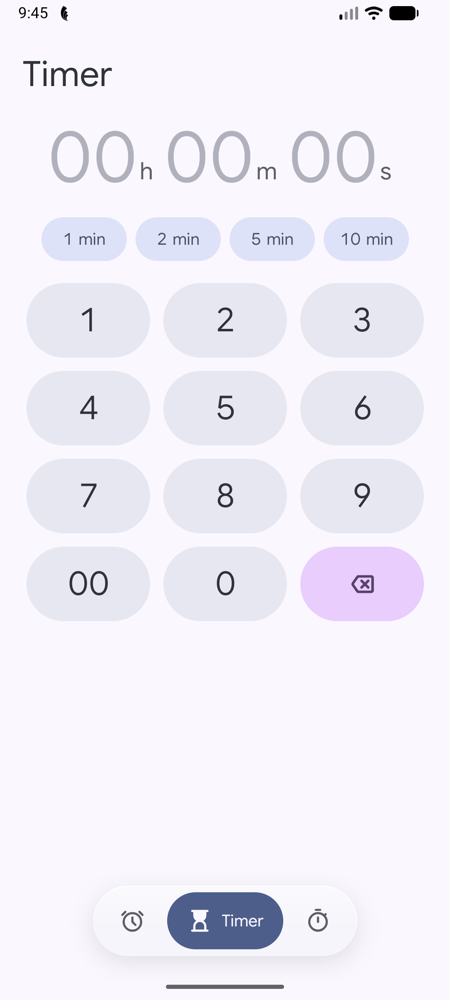
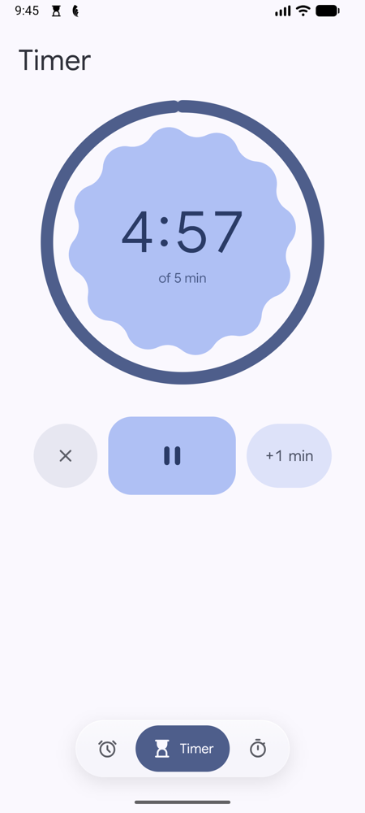
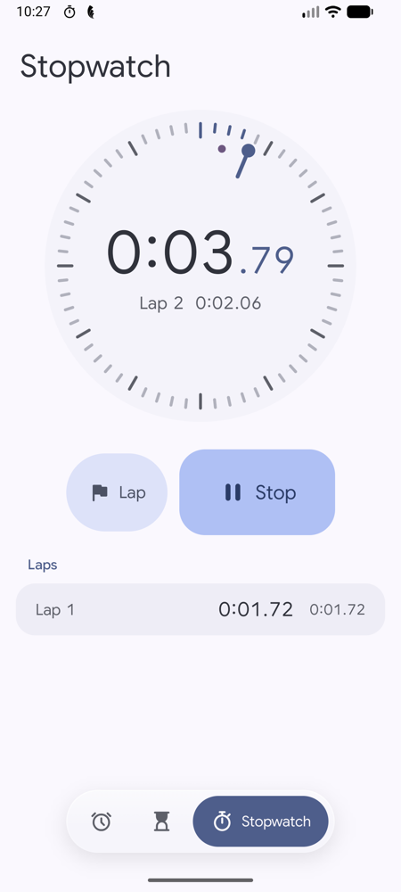
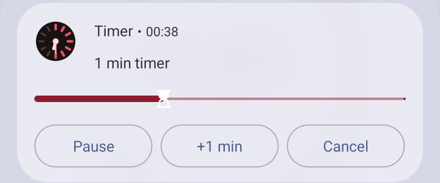
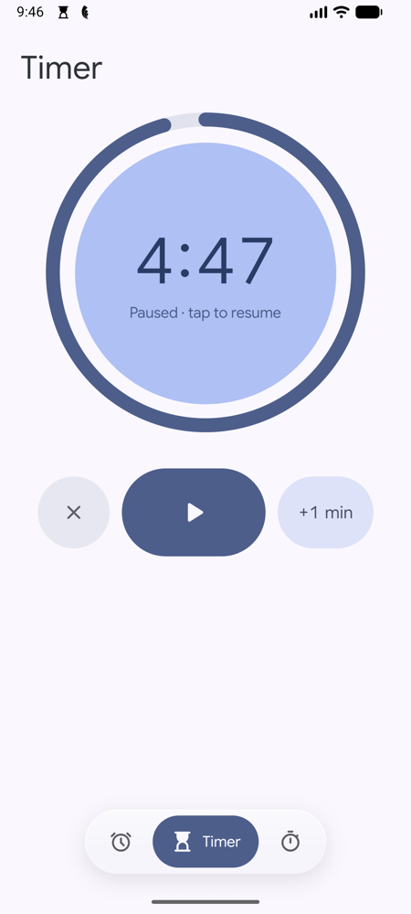
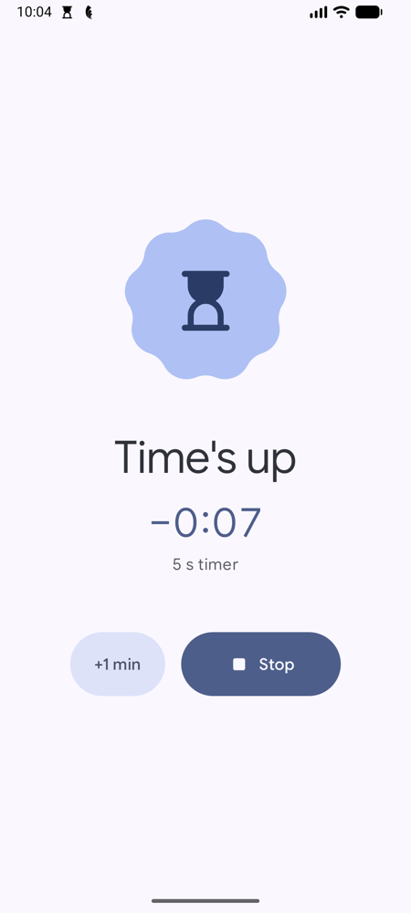

# Chronos

An Android alarm clock that makes sure you actually get up, with a countdown timer and a
stopwatch, in a Material 3 Expressive design.

Chronos is built with Expo and React Native. Anything that has to keep running when the app
is closed (alarms, timers, the stopwatch, ringing, notifications) runs in a native Kotlin and
Jetpack Compose module. The JavaScript side only draws the screens.

<p align="center">
  
  
  
  
</p>

## Features

### Alarms
- One-time, repeating (pick the days) and date alarms, each with its own sound, vibration,
  snooze length and label.
- **Wake-up check.** Choose how an alarm is stopped: slide to stop, type a phrase shown on
  screen, say it out loud (on-device speech recognition), or a secret phrase you have to
  remember. Set a default, and override it on any alarm.
- **"If I can't do it."** Give up on the phrase and the alarm goes quiet, then rings again
  every few minutes, as many times as you set.
- Limited snoozes, a volume ramp, and power or volume keys to silence a ring.
- A full-screen ringing screen over the lock screen, written in Compose, so it appears
  instantly without starting the JS runtime.
- Alarms come back after a reboot, an app update, or a time or time-zone change, and fire
  in Doze through `AlarmManager.setAlarmClock`.

### Timer
- A number pad where digits shift in from the right (HH:MM:SS), presets for 1, 2, 5 and
  10 minutes, and +1 min while running.
- A morphing timer face: a twelve-scallop cookie that turns while running, melts into a
  circle when paused, and bursts into a sun when time is up. The ring around it always
  shows the true time left. Tap the face to pause or resume.
- At zero it rings with the alarm sound and vibration. You get a heads-up notification
  with Stop and +1 min, or a full-screen "Time's up" if the phone is locked.

### Stopwatch
- A native dial with 60 tick marks, a sweeping hand and a centisecond readout in tabular
  figures, so the digits never jitter.
- Laps grow in at the top of the list, with the fastest and slowest marked.

### Everywhere
- **Keeps running in the background.** A foreground service keeps the timer and stopwatch
  going with the app closed. Their notifications use the system chronometer and have
  Pause / Lap / Reset / +1 min buttons.
- **Live Updates on Android 16+.** Both notifications become promoted Live Updates: a
  status-bar chip, top of the shade, and on the lock screen. The timer adds a progress bar.
  Older Android versions show the same notification without promotion. A notification you
  swipe away stays away until that clock starts over.
- **Launcher shortcuts** for New alarm, Timer and Stopwatch.
- **Deep links:** `chronos://timer`, `chronos://stopwatch`, `chronos://alarm/new`.

<p align="center">
  
</p>

## Design

Material 3 Expressive, with a burnt-burgundy palette (or your wallpaper colours, if you pick
"device" in Settings) and Google Sans Flex.

- **Glass tab bar.** A floating bar with real backdrop blur on Android 12+. The page scrolls
  underneath and shows through, blurred. The pill, tab widths and labels all follow the
  pager, so a swipe moves them with your finger. Icons move too: the bell rings, the
  hourglass turns over, the stopwatch hand sweeps round.
- **Morphing buttons.** Corners squeeze toward a squircle while you hold a button.
  Play/pause buttons change shape with their state.
- **Shape morphs** come from `androidx.graphics.shapes` and the Material 3 Expressive shape
  set.

<p align="center">
  
  
</p>

## How it works

```
React Native (Expo Router, @expo/ui Jetpack Compose components)
  │  renders screens, sends intents: startTimer(), lapStopwatch(), saveAlarm() …
  ▼
modules/chronos-alarms  (local Expo module, Kotlin + Compose)
  ├─ data/      AlarmStore: alarms and settings in device-protected storage
  ├─ schedule/  AlarmScheduler: setAlarmClock, boot and time-change receivers
  ├─ ringing/   RingingService, notifications, AlarmSound (shared with the timer)
  ├─ clock/     ClockEngine: timer and stopwatch state; ClockService (foreground);
  │             Live Update notifications; launcher shortcuts
  └─ ui/        Compose: ringing and Time's-up screens, plus views used from JS:
                GlassTabScaffold, TimerFace, StopwatchDial, LapList, MorphButton
```

- **Time is stored as wall-clock timestamps.** The timer is `endAt`; the stopwatch is
  `startedAt + accumulatedMs`. They survive the process being killed. JS's `Date.now()` and
  the notification chronometer both count from the same clock.
- **Fast-moving pieces draw natively.** The stopwatch dial, timer face and lap list read
  native state and redraw every frame in Compose, so the time never streams over the bridge.
- **Custom Compose views share the `@expo/ui` tree.** Each one is a `View<Props>(name)
  { Content { … } }` in the module, so it sits inside an `@expo/ui` `<Host>` beside the
  stock components.

## Tech stack

| | |
|---|---|
| Framework | Expo SDK 58, React Native 0.88, React 19.3, TypeScript |
| Navigation | Expo Router |
| UI | `@expo/ui` (Jetpack Compose), plus our own Compose views |
| Native | Kotlin, Jetpack Compose, Material 3 1.5 (Expressive), AndroidX Core |
| Platform | Android only, minSdk 24, Live Updates on API 36+ |

## Getting started

Requirements: Node 20+, JDK 17, the Android SDK, and an emulator or device.

```bash
npm install --legacy-peer-deps
```

`--legacy-peer-deps` is needed because an optional peer of `@expo/ui` (`react-dom`) asks for
a slightly newer React than the project pins.

Chronos uses its own native module, so it can't run in Expo Go. Build a development build:

```bash
npx expo run:android
```

Then iterate with Metro:

```bash
npx expo start
```

### Checks

```bash
npx expo lint
```

```bash
npx tsc --noEmit
```

### Release APK

```bash
npx expo prebuild --platform android --clean
```

```bash
cd android && ./gradlew :app:assembleRelease
```

The release build is arm64-only, minified with R8 and resource-shrunk (see
`expo-build-properties` in `app.json`); it comes out at about 14 MB. The generated project
signs release builds with the debug keystore. For Google Play, set up your own upload key or
build with [EAS](https://docs.expo.dev/build/introduction/).

`android/` is generated (Continuous Native Generation). Don't edit it by hand; configure
native behaviour in `app.json`, the config plugins in `plugins/`, or the module in
`modules/chronos-alarms`.

## Project structure

```
src/
  app/             Expo Router screens: home (tabs), alarm editor, settings, setup
  features/
    alarms/        alarm list, editor parts, hooks
    clock/         timer and stopwatch pages
    settings/      settings sections
  theme/           colour tokens and fonts
  ui/              shared components (Screen, Txt, grouped lists, icons)
modules/chronos-alarms/
  index.ts         typed JS API of the native module
  ExpressiveViews.tsx, StopwatchDial.tsx   JS wrappers for the Compose views
  android/         Kotlin sources, resources, manifest
plugins/           config plugins (animated splash)
assets/            fonts, icons (Material Symbols Rounded), splash
```

## Permissions

| Permission | Why |
|---|---|
| `USE_EXACT_ALARM`, `SCHEDULE_EXACT_ALARM` | Ring alarms and timers at the exact time |
| `POST_NOTIFICATIONS` | Ringing, snooze, timer and stopwatch notifications |
| `USE_FULL_SCREEN_INTENT` | Ringing and "Time's up" screens over the lock screen |
| `POST_PROMOTED_NOTIFICATIONS` | Live Updates on Android 16+ (granted at install) |
| `FOREGROUND_SERVICE`, `FOREGROUND_SERVICE_SYSTEM_EXEMPTED` | Keep ringing, timers and the stopwatch running |
| `RECEIVE_BOOT_COMPLETED` | Put alarms back after a reboot |
| `WAKE_LOCK`, `VIBRATE` | Ring with the screen off, vibrate |
| `RECORD_AUDIO` | Only for the "Say the phrase" wake-up check, on-device |
| `REQUEST_IGNORE_BATTERY_OPTIMIZATIONS` | Ask to be exempt from battery limits, so alarms aren't delayed |

## License

[MIT](LICENSE) © 2026 Oluwamuyiwa David
